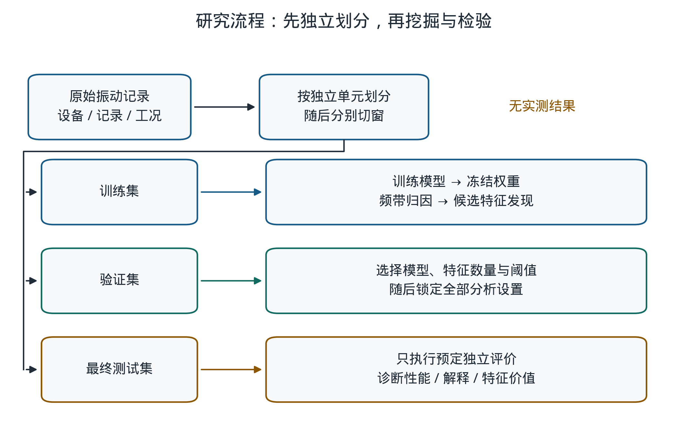
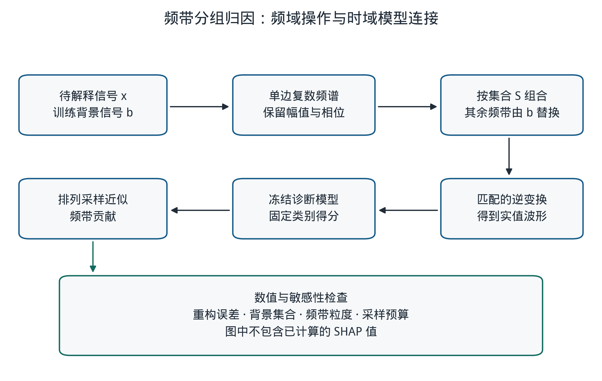
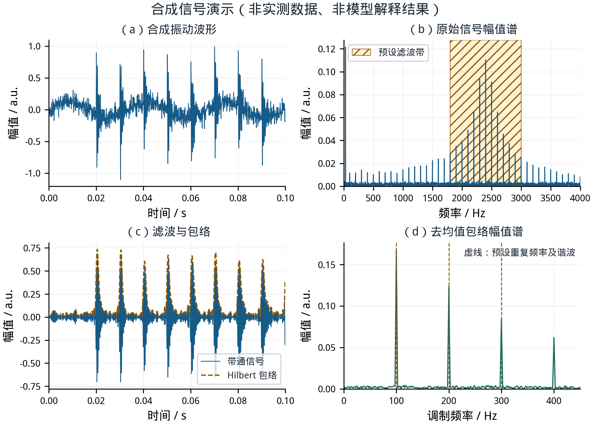
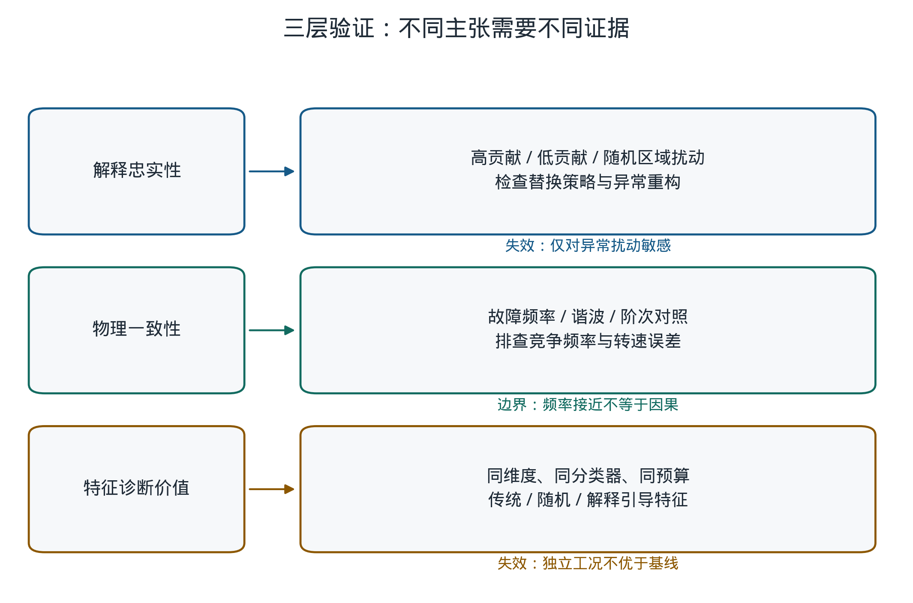

**稿件性质：方法框架与实验方案稿。** 本稿以滚动轴承振动信号为拟议验证对象，尚无真实设备数据、训练模型或实测诊断结果。图1、图2和图4为方法示意，图3为可复现的合成信号演示。作者、单位和目标期刊待确定；当前采用通用中文学术论文版式。

# 摘要

深度学习能够从机械振动信号中学习故障判别信息，但分类性能难以直接说明模型利用了哪些物理特征，也无法保证这些特征在工况变化后仍然有效。针对模型解释与实际特征挖掘之间缺少验证衔接的问题，本文构建一种解释引导的故障诊断特征挖掘框架。首先，按照独立设备或采集批次划分数据，训练并冻结一维卷积诊断模型；其次，通过频带分组归因分析模型对不同信号成分的依赖，并结合重复训练和重采样筛选稳定区域；随后，将候选区域转化为具有明确计算规则的频带能量、包络谱能量和故障阶次相关特征；最后，从解释忠实性、物理一致性及独立诊断价值三个层面设计验证实验。该框架将模型关注区域与可独立使用的诊断特征分别检验，并设置传统特征、随机特征和受控扰动作为对照。本文给出方法设计、合成信号演示与评价方案，实际性能及适用范围仍需通过独立设备数据验证。

**关键词：** 故障诊断；特征挖掘；可解释深度学习；SHAP；跨工况泛化

# 1 引言

机械设备的局部损伤可能引起振动信号中的冲击、调制及频谱结构变化。传统故障诊断通过均方根、峭度、频带能量和包络谱等指标描述这些变化。其中，包络分析能够帮助识别被结构共振调制的周期性冲击，是滚动轴承诊断的重要工具之一[1]。然而，传统特征的有效性依赖分析频带、运行工况以及故障机理，固定特征组合未必覆盖复杂运行条件。

深度学习提供了从数据中学习判别表示的途径，已有研究将深度神经网络用于旋转机械故障特征学习与智能诊断[2]。不过，模型可能同时利用故障信息、设备个体差异、采集条件和背景噪声。较高分类准确率只能说明特定测试设置下的预测能力，不能单独证明模型学习到了可迁移的故障特征。

SHAP（SHapley Additive exPlanations）和积分梯度等方法为分析模型输出与输入之间的关系提供了工具[3–4]。归因结果受到解释目标、背景样本和输入表示的影响，显著性方法还需要接受模型参数随机化等检查[5]。因此，将热力图中的高亮区域直接视为故障机理，仍然缺少必要证据。

本文研究的问题是：模型稳定依赖的信号区域，能否转化为具有明确物理含义、并在未见工况下仍有诊断价值的显式特征？本文将模型预测、解释忠实性、物理一致性和特征独立价值区分开，给出可证伪的验证路径。方法由已有信号处理与归因工具构成，其性能优势和相对现有研究的新增贡献均有待实验及近邻文献核验。

# 2 解释引导的特征挖掘方法

## 2.1 总体流程与任务定义

图1给出整体研究流程。设振动窗口为 $x_i$、故障标签为 $y_i$、工况为 $d_i$，独立采集单元为 $g_i$。模型参数为 $\theta$，类别 $c$ 的输出得分为 $f_{\theta,c}(x_i)$。诊断决策为

$$
\hat y_i=\arg\max_c f_{\theta,c}(x_i). \tag{1}
$$

数据在切窗之前按独立设备、故障实体或采集批次划分。同一原始记录及其重叠窗口只能属于一个子集。如果目标是推广到新轴承，应按物理轴承个体划分；仅按采集批次划分时，结论限定在对应推广范围。归一化参数、背景样本及数据驱动的频带发现均来自训练集，验证集负责选择配置，测试集保留至方案冻结之后。

## 2.2 基础模型与冻结策略

基础诊断器拟采用小型一维卷积神经网络，经局部卷积、非线性变换和全局聚合输出故障类别。具体层数、卷积核长度、训练轮数和优化器根据数据条件在验证阶段确定，当前不将未执行配置写成实验事实。

选模完成后冻结权重、类别映射及预处理流程。多个预先指定的随机种子分别训练模型，保存全部运行结果，用于检验训练随机性对候选区域的影响。不同种子描述算法波动，不作为新增独立设备样本。每个冻结模型的解释始终针对其固定参数开展。

## 2.3 频带分组归因

图2展示频域操作与时域模型之间的连接。将信号变换到频域，按预先确定的边界划分为 $K$ 个频带。保留待解释信号在集合 $S$ 内的复数频谱，其余频带由训练背景信号替换，然后逆变换回时域并送入冻结模型。定义

$$
v_x(S)=\frac{1}{|\mathcal B|}\sum_{b\in\mathcal B}
f_{\theta,c}\!\left(T^{-1}[M_S(Tx,Tb)]\right), \tag{2}
$$

其中 $T$ 为傅里叶变换，$\mathcal B$ 为训练背景集合，$M_S$ 为频带组合算子。实值信号采用单边复频谱与匹配的逆变换，保留复数相位信息；直流与奈奎斯特分量按实数约束处理。不把幅值谱直接当成可逆输入。

在价值函数上计算分组Shapley贡献，或在固定预算下采用排列采样近似[3]。对频带 $k$，贡献定义为

$$
\phi_k=\sum_{S\subseteq\mathcal K\setminus\{k\}}
\frac{|S|!(K-|S|-1)!}{K!}
\left[v_x(S\cup\{k\})-v_x(S)\right]. \tag{3}
$$

其中 $\mathcal K=\{1,\ldots,K\}$。正贡献表示相对背景替换提高目标得分，负贡献表示相反作用；符号不直接等同于有故障或无故障。近似计算需记录评估预算、随机种子及加和误差。

类级特征发现可对已知开发类别输出归因；解释单次诊断时固定原始预测类别，扰动后不更换目标。背景的工况与标签构成必须记录，条件匹配背景与健康背景回答不同问题。该替换操作反映模型响应，不构成真实机械故障的因果干预。

## 2.4 候选稳定性与显式特征构造

首先按独立采集单元汇总归因，避免长记录因窗口多而主导结果；再比较不同种子、训练记录重采样和背景集合下的频带排序，记录候选集合重合度及入选频率。筛选同时考虑贡献方向、排序与重复出现情况，特征数量和稳定性阈值经验证集选择，在测试前锁定。

候选区域需转化为具有明确参数的特征。拟考虑原始频带能量、包络谱能量和阶次相关特征。设候选滤波带为 $B$，包络为 $e_B(t)$，其去均值后的包络功率谱为 $P_{e_B}(f)$，则区间 $\Omega_j$ 的相对能量可定义为

$$
z_{B,j}(x)=
\frac{\int_{\Omega_j}P_{e_B}(f)\,\mathrm{d}f}
{\int_{\Omega_{\mathrm{all}}}P_{e_B}(f)\,\mathrm{d}f+\varepsilon}. \tag{4}
$$

其中 $\Omega_{\mathrm{all}}$ 为预先规定的分析范围，$\varepsilon$ 为同量纲的小正数。滤波器、边界处理、谱估计方式和区间宽度均需记录。

共振载频与故障调制频率分别处理：共振带可以用赫兹表示，随转速变化的调制频率可在可靠转速信息支持下转为阶次。明显变速时需角域重采样，不能仅用平均转速重标频率轴。基于轴承几何构造阶次特征时，对所有候选故障模式统一计算，不能根据测试样本的真实标签选择特征。

# 3 合成信号演示与证据边界

图3用已知参数的合成信号说明从共振响应到包络特征的转换。该演示没有训练分类器，也没有运行SHAP。以无量纲信号表示

$$
x(t)=\sum_m a_m e^{-\beta(t-t_m)}\sin[2\pi f_c(t-t_m)]u(t-t_m)
+A\sin(2\pi f_rt)+\sigma\eta(t), \tag{5}
$$

其中 $u$ 为阶跃函数，$\eta$ 为固定种子的标准正态白噪声。示例设采样率12.8 kHz、时长1 s、冲击重复频率100 Hz、共振载频2400 Hz、衰减率900 s$^{-1}$，每次冲击幅值 $a_m=1$；另加30 Hz、幅值0.12的正弦分量和标准差0.08的噪声。随机种子为20261115。这些数值仅用于演示，不对应某种真实轴承型号。

信号采用四阶Butterworth带通滤波器，通过二阶节正反向滤波实现零相位处理，并利用Hilbert变换计算包络。幅值谱采用Hann窗并进行相干增益校正；只在远离滤波边缘的0.1—0.9 s区间计算包络谱。正反向滤波适用于离线演示，其非因果特性不直接支持在线部署。

图3用于展示三个概念：原始频谱中的共振载频与包络谱中的重复频率不同；频带选择决定后续包络分析的输入；已知生成参数能够为特征位置检查提供参考。因为滤波带已预先给定，本图不能证明解释方法发现了有效区域，也不能证明特征具有跨工况诊断价值。相关信号数组、参数和代码随稿提供。

# 4 实验设计与评价方案

## 4.1 数据条件与公平比较

拟优先使用具备原始记录、故障标签、转速和采集单元信息的数据。同工况独立记录测试检验基本诊断能力，完整留出目标工况检验工况迁移。目标测试工况不参与训练、候选发现或选参。若源域与目标域包含同一物理轴承，结论不能扩展为跨轴承泛化；若使用目标域无标签数据，应另列域适应实验。

表1列出拟执行比较。各浅层分类组匹配特征总数、分类器、划分及调参预算；随机特征重复抽样。深度模型作为完整信号输入的性能参照，比较时说明输入信息量差异。

Table: 表1　特征独立价值的对照设计（尚未执行）

| 实验组 | 输入 | 评价目的 |
|:---|:---|:---|
| 深度模型参照 | 原始振动信号 | 提供端到端性能参照 |
| 传统特征 | 预定时域、频域和包络指标 | 建立常规基线 |
| 随机特征 | 同候选空间重复随机选取 | 检验是否优于随机选择 |
| 解释引导特征 | 稳定区域对应显式特征 | 检验独立诊断价值 |
| 融合特征 | 两类候选联合筛选、固定总维度 | 检验互补信息 |

## 4.2 解释忠实性检验

图4将评价分为三条互不替代的证据链。对高正贡献、低贡献及随机频带实施匹配扰动，目标得分下降定义为

$$
D(S)=f_{\theta,c}(x)-f_{\theta,c}(\mathcal P(x,S)), \tag{6}
$$

$$
\Delta(q)=D(S_{\mathrm{high},q})-
\mathbb{E}[D(S_{\mathrm{random},q})]. \tag{7}
$$

其中 $\mathcal P$ 为预先确定的替换策略，$q$ 为区域预算。比较匹配频带数或带宽，并检查原始频带能量差异，同时保留能量匹配与未匹配的敏感性分析。负贡献单独报告，不能直接套用正证据删除逻辑。

归因与删除实验共用扰动策略可能形成偏向，因此在原解释策略外至少比较另一种合理替换，检验结论是否只对特定算子成立。还需检查未扰动重构误差、幅值异常与频谱泄漏。即使 $\Delta(q)>0$，仍应排查异常重构波形引起的分布外响应。参数随机化检查用于考察解释是否依赖训练参数[5]。

## 4.3 物理一致性、稳定性与统计单位

候选频率与理论故障频率、谐波和边带比较时，考虑频率分辨率、转速误差及其他部件的相近频率。频率接近仅支持一致性判断，不能单独证明因果机理。不同种子、背景与记录重采样的候选集合采用重合度及排序相关性描述稳定性；空候选集合单独报告，不能当作高稳定性。

诊断性能以宏平均F1为主要指标，报告各类召回及混淆矩阵。标签一致的记录按预先确定的窗口聚合规则评价，避免长记录获得过高权重。不确定性估计和配对比较按研究目标对应的独立设备、故障实体或采集单元进行，不将相关窗口及训练种子当作独立设备。独立单元不足时，以描述性结果为主并限定推广范围。

## 4.4 预定判断与结果报告

表2规定主张、必要证据及失效情形，防止只保留有利结果。正式实验需报告独立单元数、划分、模型与解释配置、逐组性能及负结果。当前不设置虚构的结果表或准确率曲线。

Table: 表2　主张与证据对应关系

| 待检验主张 | 必要证据 | 限制或失效情形 |
|:---|:---|:---|
| 归因反映模型依赖 | 匹配干预、替换敏感性、随机化检查 | 只在异常扰动下成立 |
| 候选与机理一致 | 频率/阶次及竞争解释分析 | 仅频率接近或缺转速依据 |
| 特征可独立使用 | 同维度传统/随机对照 | 不能优于常规基线 |
| 特征可跨工况迁移 | 未参与开发的完整目标工况 | 目标数据已用于选参 |

# 5 讨论

该框架将模型关注区域、机理一致性和显式特征的诊断价值连接起来，并为每一步设置独立检验。归因方法本身用于解释冻结模型；将其转为工程特征后，仍需面对信息损失、特征相关性及工况变化。SHAP的加和性质也不能替代机械机理验证。

负结果能够帮助定位研究问题。若归因通过扰动检查而显式特征性能较弱，可能说明模型依赖多个区域的组合关系，现有公式未保留这些信息；若同工况有效而跨工况失效，应检查设备差异、能量和传递路径；若背景变化导致候选大幅变化，应优先研究解释敏感性。实际原因需由对照实验区分。

本稿相对既有工具的潜在贡献，在于组织从解释到显式特征再到独立评价的证据链，而非宣称提出了新的SHAP算法。稳定性筛选是否改善特征可靠性、解释候选是否提供传统特征之外的信息，均需要公平比较。尚未完成的近邻全文检索限制了新颖性主张。

若后续转向柴油机或喷油器，应结合曲轴转角、喷油、燃烧及气门事件重定义特征。轴承频率不能直接迁移到发动机机理。没有可靠角度或转速记录时，应缩小阶次与事件定位方面的结论。

# 6 结论与下一步

本文构建了冻结模型、频带归因、稳定性筛选、显式特征构造及独立验证的方法框架，并提供合成冲击信号演示。所给评价方案分别检验解释忠实性、物理一致性及诊断价值，能够支持后续据实判断方法收益与失效边界。

下一步先确定数据独立单元和最终测试工况，再完成传统特征与小型卷积模型基线，随后开展频带归因和匹配扰动实验。只有候选区域及特征公式锁定后，才进行独立特征比较。真实数据实验、适用范围与性能优势目前均未确立。

\clearpage

# 参考文献

[1] RANDALL R B, ANTONI J. Rolling element bearing diagnostics—A tutorial[J]. Mechanical Systems and Signal Processing, 2011, 25(2): 485–520. DOI: [10.1016/j.ymssp.2010.07.017](https://doi.org/10.1016/j.ymssp.2010.07.017).

[2] JIA F, LEI Y, LIN J, et al. Deep neural networks: A promising tool for fault characteristic mining and intelligent diagnosis of rotating machinery with massive data[J]. Mechanical Systems and Signal Processing, 2016, 72–73: 303–315. DOI: [10.1016/j.ymssp.2015.10.025](https://doi.org/10.1016/j.ymssp.2015.10.025).

[3] LUNDBERG S M, LEE S I. A Unified Approach to Interpreting Model Predictions[C]//Advances in Neural Information Processing Systems. 2017, 30. [arXiv:1705.07874](https://arxiv.org/abs/1705.07874).

[4] SUNDARARAJAN M, TALY A, YAN Q. Axiomatic Attribution for Deep Networks[C]//Proceedings of the 34th International Conference on Machine Learning. 2017, 70: 3319–3328. [PMLR原文入口](https://proceedings.mlr.press/v70/sundararajan17a.html).

[5] ADEBAYO J, GILMER J, MUELLY M, et al. Sanity Checks for Saliency Maps[C]//Advances in Neural Information Processing Systems. 2018, 31. [arXiv:1810.03292](https://arxiv.org/abs/1810.03292).

# 附记：制作与证据说明

稿件文字组织与图形代码由AI辅助完成，作者信息待确认；提交学术期刊前需由研究者核验论证、文献原文、数据与结论，并按目标期刊要求披露辅助工具。参考文献用于标明既有方法来源，不表示本仓库已复现其研究。

可视化制作采用Scientific Agent Skills的科学可视化工作流作为方法指导；其引用记录见[制作说明](README.md)，不作为故障诊断研究证据。图形代码、原始合成数组及验证报告随稿发布。
